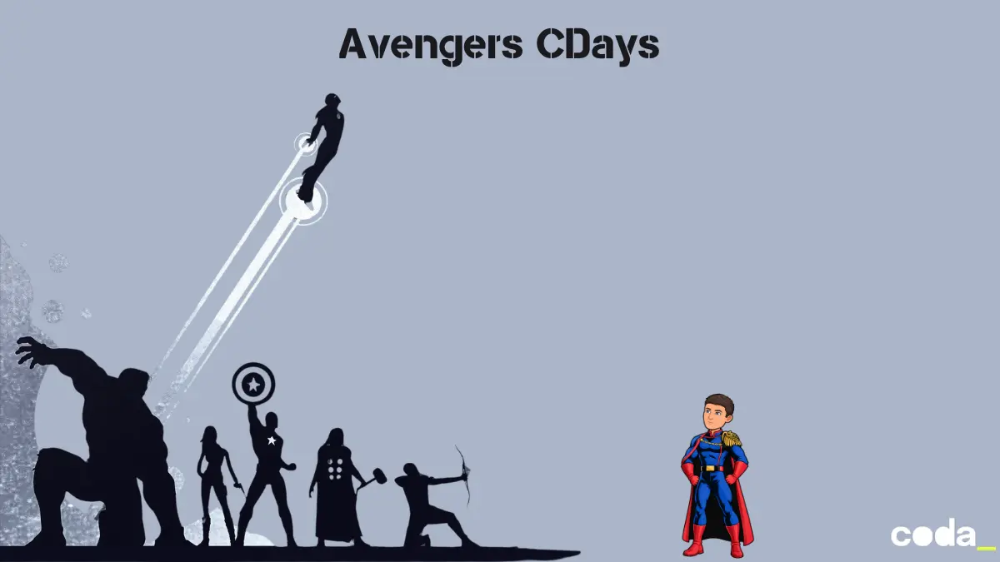

## Avengers: CDays

Une série d'exercices en C pour découvrir à la fois l'algorithmique et le langage C, sur le thème des Avengers. Chaque épisode ajoute une notion, en réutilisant tout ce qui a déjà été vu.

- [Episode 0 : Avengers, Assemble !](episode00/README.md)
- [Episode 1 : L'Appel des Vengeurs](episode01/README.md)
- [Episode 2 : Le Compteur du Tesseract](episode02/README.md)
- [Episode 2 bis : Le Protocole de Vision](episode02bis/README.md)
- [Episode 3 : Le Scanner des Vengeurs](episode03/README.md)
- [Episode 4 : Le Détecteur du Plus Fort](episode04/README.md)
- [Episode 5 : La Moyenne de Puissance du Groupe](episode05/README.md)
- [Episode 6 : Le Seuil d'Alerte](episode06/README.md)
- [Episode 7 : Le Classement des Vengeurs](episode07/README.md)
- [Episode 8 : Le Cri de Guerre](episode08/README.md)
- [Episode 9 : Le Message Inversé](episode09/README.md)
- [Episode 10 : L'Unicité des Vengeurs](episode10/README.md)
- [Episode 11 : Le Recensement des Vengeurs](episode11/README.md)
- [Episode 12 : La Séquence des Particules Pym](episode12/README.md)
- [Episode 13 : Le Code Secret de Loki](episode13/README.md)
- [Episode 14 : La Pile de Réparation de Stark](episode14/README.md)
- [Episode 15 : Le Mainframe de Doom](episode15/README.md)
